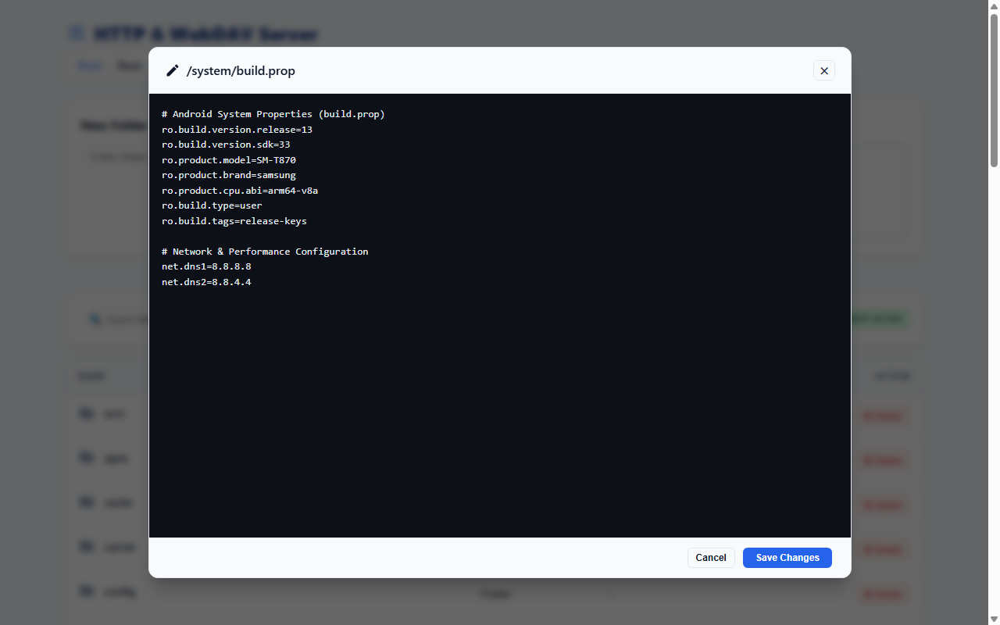

# HTTP & WebDAV File Server for Android (WebDAV++)

A lightweight, high-performance HTTP and WebDAV server application designed for Android devices. Turn any Android phone or tablet into network-attached storage (NAS) and mount your internal storage and external SD cards directly in Windows File Explorer, macOS Finder, Linux file managers, or web browsers with zero accounts and zero cloud sign-in.

---

## ⚠️ Disclaimer & Safe Use Notice

> [!CAUTION]
> **PLEASE READ BEFORE USING:**
> 1. **Protocol Scope:** This application is strictly an **HTTP & WebDAV** file server for Android. It does not provide or run an SMB/CIFS server daemon.
> 2. **Client Helper Scripts:** The downloadable Windows batch scripts (`unlock-webdav.bat`, `mount-rclone.bat`, `disconnect-drive.bat`) and system registry optimizations are optional convenience tools provided **AS-IS**.
> 3. **User Responsibility:** You download, execute scripts, and adjust your local operating system or network configuration **entirely at your own risk**. The authors and contributors assume no liability or responsibility for system settings modifications, network disruptions, file corruption, or data loss.

---

## ✨ Key Features

- **Standard WebDAV Support (Class 1 & 2):** Mount your device storage directly as a mapped network drive in Windows File Explorer (`S:\`), macOS Finder, or Linux file managers.
- **Automatic Storage & SD Card Detection:** Automatically discovers Internal Storage and external removable SD cards (`/storage/XXXX-XXXX`) on startup without manual path entry.
- **Granular Folder Sharing:** Checkbox toggles on each configured drive (both Internal Storage and SD Card are enabled by default) with pixel-perfect visual alignment and clear status badges.
- **Windows 1-Click Network Drive Hub (Web UI):**
  - **⚡ Native Windows WebDAV (`Zero Install`):** 1-click batch script that unlocks the 4GB file transfer limit, eliminates the 10-second WPAD proxy freeze, and maps Drive `S:`.
  - **🚀 Virtual Drive (`Local Cache`):** Offline-first virtual disk using WinFsp and Rclone with instant photo thumbnails, parallel chunk streaming, and automatic drive collision resolution.
  - **🔌 Disconnect & Cleaner (`Reset Mounts`):** Interactive universal disconnect script to safely unmount any drive letter (`S:`, `Z:`, or `ALL`) and purge stale Windows Explorer ghost mounts.
- **In-Browser Web File Manager & Code Editor:**
  - Responsive file browser accessible from any browser on your local network.
  - Real-time instant file search filter.
  - In-browser code and config editor (Monaco Editor) with direct write-back via WebDAV PUT.
  - Live storage metrics and root status badges.
- **Root Filesystem Access & Simulator:**
  - Optional root mode leveraging Linux mount namespace isolation (`su -mm`) to view and modify true system partitions (`/data`, `/system`, `/vendor`) without zygote mount virtualization.
- **Native Android Dashboard:**
  - Modern Material Design 3 user interface with Jetpack Compose.
  - Dynamic QR code generation for quick client connections.
  - Real-time HTTP access log viewer with status code highlighting.
  - Persistent foreground service with Wi-Fi lock and battery optimization handling.
  - Multi-language support (English and Traditional Chinese).

---

## 📸 Screenshots

<div align="center">

### Android App Dashboard


### Web File Browser


### In-Browser Code & Config Editor


</div>

---

## 🖥️ Connecting as a Network Drive

### Windows 11 / 10 (1-Click or Manual)

#### Method A: 1-Click Web Hub (Recommended)
1. Open `http://<DEVICE_IP>:<PORT>/` in your PC's web browser.
2. Under the **Windows Network Drive Hub**, click **⚡ 4GB Unlock & Map S: (.bat)**.
3. Run the downloaded script — it applies speed tweaks, restarts WebClient, and opens Drive `S:\` in File Explorer.

#### Method B: Manual Mapping
1. Open **File Explorer** and click **This PC** -> **Map network drive**.
2. In the **Folder** field, enter:
   ```
   http://<DEVICE_IP>:<PORT>/
   ```
   *(or `\\<DEVICE_IP>@<PORT>\DavWWWRoot`)*

---

### macOS Finder
1. In **Finder**, press `Cmd + K` (Connect to Server).
2. Enter the server address:
   ```
   http://<DEVICE_IP>:<PORT>/
   ```
3. Click **Connect**.

---

### Linux (GNOME Files / Dolphin)
1. Open the file manager and select **Other Locations**.
2. In the connect box, enter:
   ```
   dav://<DEVICE_IP>:<PORT>/
   ```
3. Click **Connect**.

---

## 🛠️ Building & Testing

### Prerequisites
- Android Studio Ladybug / Meerkat or later
- JDK 17 or higher
- Android SDK Platform 36 (Min SDK: 24)

### Build Commands
```bash
# Assemble debug APK
./gradlew assembleDebug --quiet

# Assemble release APK
./gradlew assembleRelease --quiet
```

---

## 📱 Android Deployment: Samsung Dual Messenger Protection

> [!IMPORTANT]
> If testing or deploying to Samsung Galaxy devices (e.g., Galaxy Tab S9+, Tab S7) where **Samsung Dual Messenger** is active:
> - **Always install targeting `--user 0`:**
>   ```powershell
>   adb -s <serial> install -r -d --user 0 "app/build/outputs/apk/debug/app-debug.apk"
>   ```
> - Never run `adb install` without `--user 0`, or Android will install to all profiles (including `UserInfo{95:DUAL_APP}`), causing unwanted duplicate icons with orange badges.

---

## 📋 Changelog
See [CHANGELOG.md](CHANGELOG.md) for full version history and release notes.

---

## 📄 License
This project is licensed under the Apache License 2.0.
