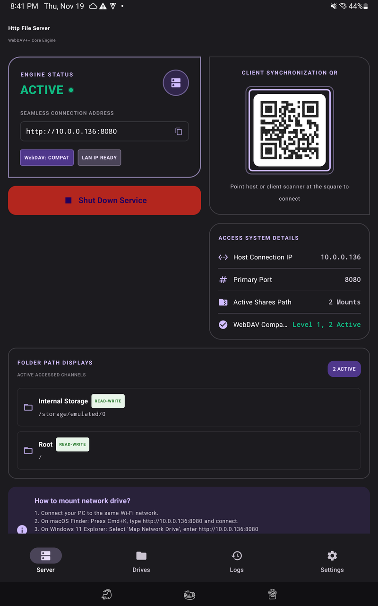
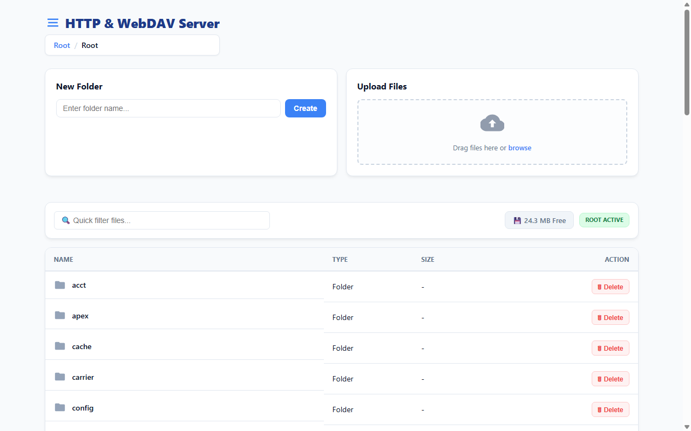

# HTTP & WebDAV File Server for Android

A lightweight, high-performance HTTP and WebDAV server application designed for Android devices. Turn your Android phone or tablet into a network-attached storage (NAS) share, enabling seamless file management across Windows, macOS, Linux, and web browsers.

---

## Key Features

- **Standard WebDAV Support (Class 1 & 2):** Mount your device storage directly as a mapped network drive in Windows File Explorer (`X:\`), macOS Finder, or Linux file managers.
- **Root Filesystem Access & Global Namespace Breakout:** Optional root mode leveraging Linux mount namespace isolation (`su -mm`) to view and modify true system partitions (`/data`, `/system`, `/vendor`) without zygote mount virtualization.
- **In-Browser Web File Manager:**
  - Responsive file browser accessible from any browser on your local network.
  - Real-time instant file search filter.
  - Live storage metrics and root status badges.
  - In-browser code and text editor with direct write-back via WebDAV PUT.
  - Multi-file drag-and-drop uploader with progress tracking.
- **Native Android Dashboard:**
  - Modern Material Design user interface.
  - Dynamic QR code generation for quick client connections.
  - Real-time HTTP access log viewer with status code highlighting.
  - Background foreground service with Wi-Fi lock and optional status bar notification.
  - Customizable port, authentication credentials, and timeout configurations.
  - Multi-language support (English and Traditional Chinese).

---

## Screenshots

<div align="center">

### Android App Dashboard


### Web File Browser


### In-Browser Code & Config Editor


</div>

---

## Connecting as a Network Drive

### Windows 11 / 10
1. Open **File Explorer** and click **This PC**.
2. Select **Map network drive** from the top menu.
3. In the **Folder** field, enter:
   ```
   \\<DEVICE_IP>@<PORT>\DavWWWRoot
   ```
   *(Example: `\\192.168.1.50@8080\DavWWWRoot`)*
4. If authentication is enabled in the app, check **Connect using different credentials** and enter your username and password.

> **Windows Registry Note for HTTP WebDAV:**
> Windows WebClient requires a registry setting to connect over plain HTTP:
> 1. Open `regedit` and navigate to:
>    `HKEY_LOCAL_MACHINE\SYSTEM\CurrentControlSet\Services\WebClient\Parameters`
> 2. Change `BasicAuthLevel` to `2`.
> 3. Restart the `WebClient` service via Command Prompt:
>    ```cmd
>    net stop WebClient
>    net start WebClient
>    ```

### macOS Finder
1. In **Finder**, press `Cmd + K` (Connect to Server).
2. Enter the server address:
   ```
   http://<DEVICE_IP>:<PORT>/
   ```
3. Click **Connect** and supply credentials if required.

### Linux (GNOME Files / Dolphin)
1. Open the file manager and select **Other Locations**.
2. In the connect box, enter:
   ```
   dav://<DEVICE_IP>:<PORT>/
   ```
3. Connect and authenticate.

---

## Building from Source

### Prerequisites
- Android Studio Ladybug or newer
- JDK 17 or higher
- Android SDK Platform 36 (Android 15/16)
- Min SDK: Android 7.0 (API 24)

### Command Line Build
```bash
# Clone the repository
git clone https://github.com/chyunkeru/HTTP-File-Server-WebDAV-.git
cd HTTP-File-Server-WebDAV-

# Assemble debug APK
./gradlew assembleDebug

# Assemble release APK
./gradlew assembleRelease
```
The output APK will be generated under `app/build/outputs/apk/`.

---

## Technical Architecture

- **HTTP & WebDAV Engine:** Lightweight socket server implementation supporting `PROPFIND`, `PROPPATCH`, `MKCOL`, `GET`, `HEAD`, `PUT`, `DELETE`, `MOVE`, `COPY`, `LOCK`, `UNLOCK`, and `OPTIONS`.
- **Root Operations:** Low-level file system interactions utilize optimized single-pass shell commands (`ls -la -e` / `stat`) wrapped in `su -mm` to bypass Android process container boundaries.
- **Database:** Android Jetpack Room for persistent server configuration and access logs.
- **UI:** Jetpack Compose with Material 3 components.

---

## License

This project is licensed under the Apache License 2.0.
